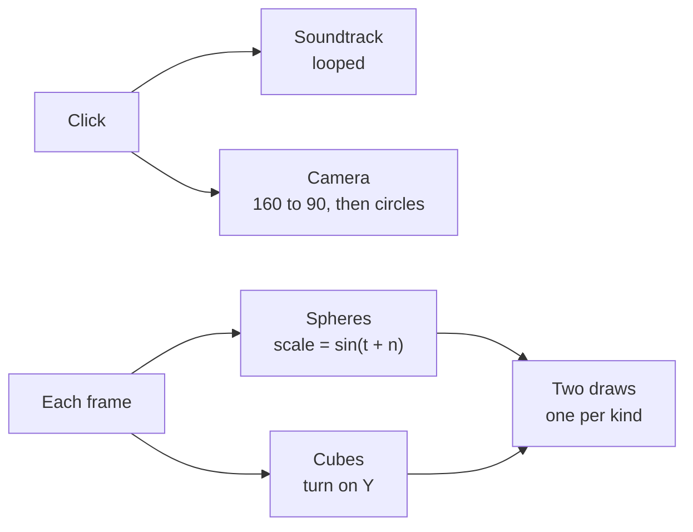

<p align="center"></p>

# Awakening

A Three.js piece to watch and listen to. A thousand spheres and a thousand cubes hang in a lattice, ten to a side. The spheres swell and shrink out of step, the cubes turn, and the camera pushes in once and then circles, to a soundtrack.

I just wanted to learn Three.js and chill. It started from a scaffold, but the textures, soundtrack, title and motion are mine.

## What happens

1. The page opens on the title over the lattice, waiting for a click. A browser will not start sound before one.
2. The click starts the soundtrack and the camera moves in from 160 units to 90.
3. From there the camera circles by itself. Drag to look from anywhere, including from below, where the title and signature sit. **M** turns the sound off and on.

## How it works



- **The wave is one expression.** A sphere's scale is `Math.sin(t + n)`, where `n` is its number in the lattice. Each sphere sits one radian further along the sine than the one before it, so a swell crosses the grid. The scale goes below zero, so every sphere shrinks to nothing and comes back.
- **Two draws for 2,000 objects.** The spheres are one instanced mesh and the cubes another. Each frame writes 2,000 matrices and the GPU draws each kind in a single call.
- **The far side fades out.** The camera sees 130 units. Fog from 62 to 128 units takes the far rows into the dark before that limit.
- **Motion runs on time.** The push-in is 60 units a second and the cubes turn 0.6 radians a second, so the piece looks the same at 60 Hz and at 144 Hz.
- **No lights.** The spheres and cubes use unlit materials. The look is two textures: fire on the spheres, mud on the cubes.

## Stack

- Three.js 0.160: `InstancedMesh`, `OrbitControls`, `TextGeometry`, `Audio`
- Vite

## Running it

```bash
npm install
npm run dev
```

Opens on http://localhost:5191. `npm run build` writes the site to `dist`.

## Credits

- The title is set in Helvetiker, which ships with the Three.js examples (licence in `public/fonts/LICENSE`).
