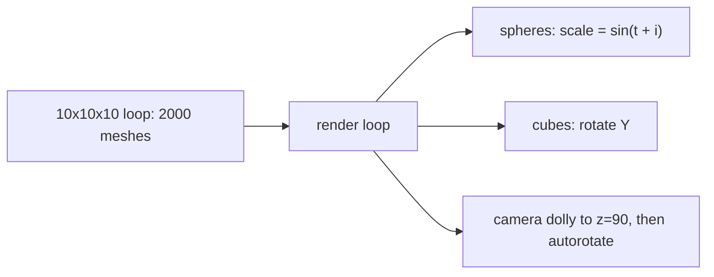

# Awakening

An interactive Three.js art piece. A lattice of pulsing spheres and turning cubes fills space around a title, a soundtrack loops, and the camera pushes in before it starts to orbit.

## What it is

This one I am genuinely proud of. It began from a Three.js scaffold, but the textures, the soundtrack, the title, and the motion are all mine. You load it and the camera drifts inward through a field of fire and mud. The words "Awakening / By Aenoris" settle into view, and the lattice starts to breathe. Drag to look around; left alone, it rotates on its own.

## What it does

- A 10 by 10 by 10 grid of objects: 1000 spheres and 1000 cubes filling a cube of space
- Spheres pulse in scale, cubes rotate, so the field never sits still
- 3D beveled text for the title, drawn with a matcap material
- Fire and mud textures on the geometry, lit by ambient, directional, and point lights
- A looping soundtrack through the Three.js audio listener
- An opening camera dolly, then automatic orbit, with drag to look

## How it works

### The breathing lattice

A triple nested loop instantiates 2000 meshes, 1000 spheres and 1000 cubes, sharing two materials and two textures. In the render loop each sphere's scale is driven by `Math.sin(elapsedTime + i)`, where `i` is the mesh index. Every sphere sits a little further along its sine than its neighbor, so a wave ripples across the grid. The cubes spin on their Y axis each frame. For the first 8 seconds the camera pushes from z = 160 toward the center for the reveal, then OrbitControls autoRotate takes over. Each mesh is tracked by its scene id and looked up per frame to animate it.



## Tech stack

- Rendering: Three.js r130, WebGL
- Tooling: Webpack, Babel, dat.gui
- Assets: custom fire and mud textures, a beveled 3D title, a soundtrack

## Running it

```bash
npm install
npm run dev       # http://localhost:8080
npm run build     # production build in dist/
```

A built `dist/` is already checked in.

## Status

A standalone Three.js scene from my own work, made to be watched and listened to.
